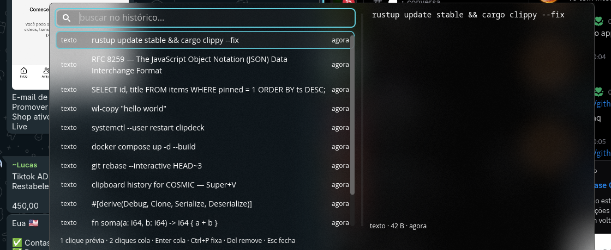

<div align="center">

# clipdeck

**Histórico da área de transferência para o COSMIC.**
Aperte <kbd>Super</kbd>+<kbd>V</kbd>, busque o que você copiou e cole direto no app em que
estava trabalhando.

[](LICENSE)


[English](README.md) · [Português](README.pt-BR.md)

</div>

---



## Por quê

O COSMIC é um desktop ótimo, mas não tem histórico da área de transferência. Você copia
alguma coisa, três passos depois quer de volta — e sumiu: só a seleção atual sobrevive.

Outros desktops Wayland resolvem isso com um daemon separado. O clipdeck faz isso de
forma nativa, num binário Rust só:

- **Sem daemon de terceiros, sem serviço externo, sem rede.**
- **Observa o clipboard sem precisar de foco**, via
  `zwlr_data_control_manager_v1`.
- **Cola no app em que você já estava**, injetando a tecla de colar pelo teclado virtual
  do compositor.
- **Segue o tema do COSMIC**, incluindo o modo vidro.

## Recursos

- Popup no <kbd>Super</kbd>+<kbd>V</kbd> com busca de texto completo (sem acento, sem
  distinguish maiúsculas, por prefixo)
- Foco no teclado: setas/Tab para navegar, <kbd>Enter</kbd> para colar — o mouse é
  opcional
- Fixar itens para não saírem pelo limite de histórico
- Prévia rica: imagens em tamanho grande, texto e arquivos no lugar, HTML convertido
  para texto puro
- Itens HTML vão para o clipboard com `text/html` **e** `text/plain`, então colar num
  campo de texto ou terminal entrega texto limpo, não marcação
- Deduplicado por SHA-256: copiar o mesmo conteúdo de novo sobe o item para o topo em
  vez de duplicar
- Respeita `x-kde-passwordManagerHint: secret` — gerenciadores de senha nunca são
  gravados
- Histórico em SQLite que sobrevive a reinícios, com limites de tamanho e quantidade
- CLI completa para automatizar e `doctor` para diagnosticar a instalação

## Requisitos

- **COSMIC** (testado no 1.8.0) sobre Wayland
- O compositor precisa expor `zwlr_data_control_manager_v1`, `zwlr_layer_shell_v1` e
  `zwp_virtual_keyboard_manager_v1` — o `clipdeck doctor` confere
- Ligado dinamicamente contra glibc (compilado e testado no CachyOS / Arch)

## Instalação

```sh
curl -fsSL https://raw.githubusercontent.com/pdl-clay/clipdeck/main/install.sh | bash
```

O script baixa o último release, confere o checksum, instala o binário em
`~/.local/bin`, grava o autostart e adiciona o atalho <kbd>Super</kbd>+<kbd>V</kbd>. Ele
mostra o que fez e onde.

Para instalar uma versão específica, ou pular o registro do atalho:

```sh
curl -fsSL https://raw.githubusercontent.com/pdl-clay/clipdeck/main/install.sh | bash -s -- --version v0.1.0
curl -fsSL https://raw.githubusercontent.com/pdl-clay/clipdeck/main/install.sh | bash -s -- --no-setup
```

### Do código-fonte

Você precisa do Rust 1.93+ e dos headers de desenvolvimento do Wayland:

```sh
# Arch / CachyOS
sudo pacman -S --needed base-devel wayland libxkbcommon libinput seat

# Debian / Ubuntu
sudo apt install build-essential pkg-config libwayland-dev libxkbcommon-dev libinput-dev libseat-dev

git clone https://github.com/pdl-clay/clipdeck
cd clipdeck
cargo install --path . --locked
clipdeck install
```

## Uso

| Ação | Resultado |
|---|---|
| <kbd>Super</kbd>+<kbd>V</kbd> | abre/fecha o popup |
| digitar | busca no histórico |
| <kbd>↑</kbd> <kbd>↓</kbd> ou <kbd>Tab</kbd> | navega |
| <kbd>Enter</kbd> | coloca o item no clipboard e cola |
| <kbd>Shift</kbd>+<kbd>Enter</kbd> | cola como texto puro (ignora a marcação HTML) |
| 1 clique numa linha | seleciona e mostra a **prévia** (não cola) |
| 2 cliques na linha | cola o item e fecha |
| clique fora do painel | fecha |
| <kbd>Ctrl</kbd>+<kbd>P</kbd> | fixa/desfixa — itens fixados não saem pelo limite |
| <kbd>Delete</kbd> | remove o item |
| <kbd>PageUp</kbd> / <kbd>PageDown</kbd> | rolam a prévia de textos grandes |
| <kbd>Esc</kbd> | fecha |

## CLI

```sh
clipdeck list [--limit N] [--json]   # itens recentes
clipdeck search <termo>              # busca de texto completo
clipdeck copy <id> [--plain]        # devolve um item ao clipboard
clipdeck pin <id> | clipdeck unpin <id>
clipdeck remove <id>
clipdeck clear [--keep-pinned] --yes
clipdeck status [--json]            # estado do banco e da configuração
clipdeck doctor                     # diagnostica protocolos, atalho e teclado virtual
clipdeck key ctrl+v | super+v | up | down | enter | escape | delete | tab
clipdeck install | clipdeck uninstall [--purge]
```

O `clipdeck key` envia uma combinação para a janela em foco sem roubar o foco — útil
para automatizar.

## Configuração

`~/.config/clipdeck/config.toml` — o arquivo é opcional; estes são os padrões:

```toml
max_items        = 500          # itens no histórico (fixados não contam)
max_total_bytes  = 268435456    # teto somando tudo (256 MiB)
max_item_bytes   = 20971520     # teto por item (20 MiB)
max_text_bytes   = 1048576      # teto para texto (1 MiB)
auto_paste       = true         # cola automaticamente após escolher
paste_delay_ms   = 150          # espera para o foco voltar ao app anterior
popup_width      = 1000
popup_height     = 460
```

Ajustes de popup e de colagem passam a valer na próxima abertura do popup; os limites
de captura (`max_*`) valem a partir do próximo início do daemon.

## Como funciona

- **Captura** — uma thread própria conectada ao Wayland via
  `zwlr_data_control_manager_v1` (observa o clipboard sem precisar de foco). A cada nova
  seleção escolhe o melhor tipo MIME disponível —
  `text/uri-list` → imagem → `text/html` (com o `text/plain` companheiro) → texto — e
  grava no SQLite.
- **Dedupe** — SHA-256 do conteúdo. Copiar de novo o mesmo conteúdo sobe o item para o
  topo em vez de duplicar.
- **Popup** — instância única por ativação D-Bus. A janela é uma layer surface de tela
  cheia transparente: o painel fica centralizado, o blur do tema é aplicado só no
  retângulo do painel e o resto da superfície captura o clique de fora (que fecha). Como
  a superfície cobre a saída, o ponteiro nunca sai dela — o compositor não devolve o
  foco para outra janela no meio do uso do mouse.
- **Colagem** — a seleção é publicada pelo próprio clipdeck
  (`zwlr_data_control_manager_v1`), com um conteúdo por tipo MIME — item HTML oferece a
  marcação em `text/html` e o texto em `text/plain`. Com `auto_paste`, um
  <kbd>Ctrl</kbd>+<kbd>V</kbd> é injetado pelo teclado virtual do compositor depois que o
  popup fecha. Se a injeção falhar, o item continua no clipboard — é só colar à mão.
- **Imagens** — miniatura de 256 px (lista) e prévia de 1024 px (painel direito) no
  banco; o original em BLOB é o que vai para o clipboard.

## Privacidade

- Tudo fica na sua máquina. Nada sai daqui.
- Ofertas marcadas com `x-kde-passwordManagerHint: secret` (gerenciadores de senha) não
  são gravadas.
- O histórico fica em `~/.local/share/clipdeck/history.db` (SQLite em WAL). Apague
  quando quiser com `clipdeck clear` ou `clipdeck uninstall --purge`.

## Limites conhecidos

- Só o clipboard normal; a seleção primária (X11) não é observada.
- O auto-paste injeta <kbd>Ctrl</kbd>+<kbd>V</kbd>; terminais costumam usar
  <kbd>Ctrl</kbd>+<kbd>Shift</kbd>+<kbd>V</kbd> — neles use o atalho do terminal, ou
  desligue `auto_paste` e cole à mão.
- O auto-paste depende de o foco voltar ao aplicativo anterior; o `paste_delay_ms`
  ajusta a espera em ambientes mais lentos.
- Aplicativos que servem a seleção e morrem em seguida podem entregar conteúdo vazio;
  nesse caso a cópia é ignorada — se for o seu caso, combine com o `wl-clip-persist`.

## Diagnóstico

```sh
clipdeck doctor
```

Confere os protocolos Wayland necessários, se o compositor deixa o clipdeck servir o
clipboard, a disponibilidade do teclado virtual, o autostart e o atalho
<kbd>Super</kbd>+<kbd>V</kbd>.

Se o atalho não disparar, lembre que o <kbd>Super</kbd>+<kbd>V</kbd> também **fecha** o
popup quando ele já está aberto. Também dá para vincular à mão em **Ajustes → Teclado →
Atalhos personalizados**, com o comando `clipdeck --toggle`.

## Desinstalar

```sh
clipdeck uninstall            # remove autostart e atalho, mantém o histórico
clipdeck uninstall --purge    # remove também o banco
```

## Contribuindo

Issues e pull requests são bem-vindos — veja [CONTRIBUTING.md](CONTRIBUTING.md).

```sh
cargo fmt --all
cargo clippy --all-targets -- -D warnings
cargo test --release
```

Pushes com tag (`v*`) geram e publicam os binários de release pelo GitHub Actions.

## Licença

[MIT](LICENSE) © Luan Rhiston